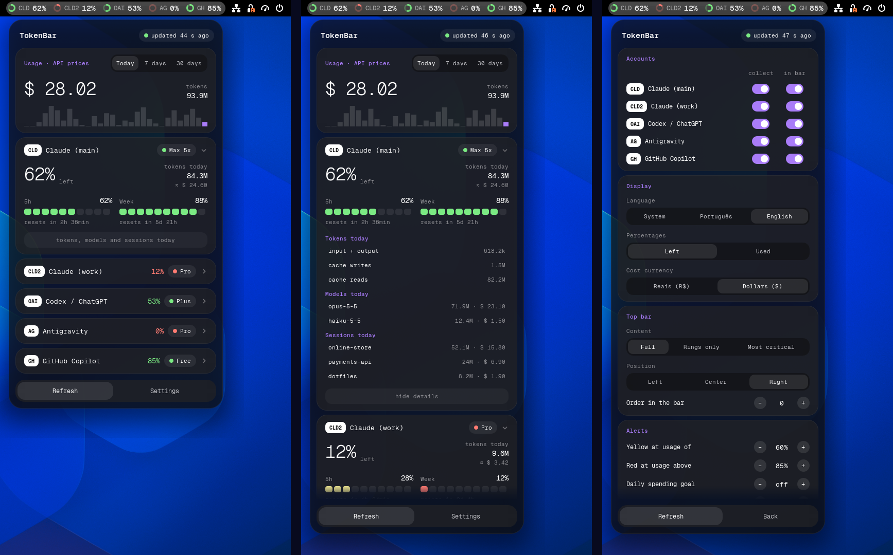

# TokenBar

**English** · [Português](README.pt-BR.md)

AI usage limits, always visible in the GNOME top bar.

TokenBar shows how much of your **Claude Code**, **Codex / ChatGPT**,
**Antigravity** and **GitHub Copilot** quota is left, and opens a panel with
the details when you click it. No Electron, no floating window, no overlay: a
small Node collector writes a JSON file and a native GNOME Shell extension
draws it.




> The interface is available in English and Portuguese and follows your
> system language.

## Features

- **Top bar**: one ring per account that drains as you use the quota, coloured
  by how close you are to the limit. Compact modes: rings only, or only the
  most critical account.
- **Panel**: one collapsible card per account with 5-hour and weekly windows,
  reset countdowns and a "runs out in ~1h 20min" projection based on your
  recent pace.
- **Cost estimate**: what today's Claude usage would cost at API list prices
  (per model, including cache writes and reads), in USD or BRL, for today, the
  last 7 days or the last 30 days, with a daily chart.
- **Per-account details**: token breakdown, models used and the sessions
  (projects) that spent the most today. Click a session to open its folder.
- **Notifications** when a window crosses your red threshold, when it frees up
  again, when an account loses its login, and when you hit a daily spending
  goal.
- **Service status**: a banner appears only when status.claude.com reports an
  incident.
- **Settings inside the panel**: accounts, what the bar shows, colour
  thresholds, goals, currency, language, collector interval, position.
- Keyboard shortcut (`Super`+`Alt`+`T`) and CSV export of the daily history.
- **Update notice**: once a day it checks GitHub for a newer version and shows
  a banner (can be turned off).

## Supported providers

| Bar label | Tool | Where the data comes from | Notes |
| --- | --- | --- | --- |
| `CLD`, `CLD2`… | Claude Code | `~/.claude` and any `~/.claude-<name>` (the ones you use with `CLAUDE_CONFIG_DIR`) | Limits from Anthropic's usage endpoint with your existing login; tokens and cost from local transcripts. |
| `OAI` | Codex / ChatGPT | `~/.codex/auth.json` | Limits only. |
| `AG` | Antigravity | The language server Antigravity itself runs on `127.0.0.1` | Works while the Antigravity IDE is open; otherwise shows the last known value. |
| `GH` | GitHub Copilot | The official `gh` CLI (`gh api`) | Monthly quotas. Needs `gh auth login`. |

**None of these tools is required.** TokenBar shows whichever ones you have:
an account only appears if its folder exists on your machine, and each one can
be switched off in the settings. You can use it with Claude Code alone, for
example, and you do not need Antigravity installed.

Claude Code, Codex and Copilot are read the same way whether you use them in a
terminal, in VS Code or in any other editor. Antigravity is the only one that
depends on its own app: its card needs the Antigravity IDE running (the `agy`
terminal CLI on its own is not detected).

## Requirements

- GNOME Shell **48, 49 or 50** (developed and tested on Fedora 44 with GNOME
  50 on Wayland; 48 and 49 are declared compatible but not yet tested by the
  author; reports welcome).
- Node.js **20+**, with no npm dependencies.
- systemd user services (standard on Fedora, Ubuntu, Debian, Arch, openSUSE).
- `ss` from iproute2 (for Antigravity) and `gh` (for Copilot), both optional.

It is a GNOME Shell extension, so it does not work on KDE, Xfce, Cinnamon or
other desktops.

## Install

```sh
git clone https://github.com/diogobritodesign/tokenbar.git
cd tokenbar
./install.sh
```

Then **log out and back in**.

To update later: `git pull && ./install.sh`, then log out and back in. On Wayland, GNOME Shell only loads a newly
installed extension (or new extension code) when the session starts.

`./uninstall.sh` removes everything: the service, the extension, its settings,
the font, the cache and the history.

## How it works

```
 tools' own files / local servers / APIs
                 │  (read-only)
        ┌────────▼─────────┐   every 60–600 s    ┌──────────────────────────┐
        │  collector (Node) ├────────────────────►  ~/.cache/tokenbar/       │
        │  systemd --user   │  atomic write       │      state.json          │
        └───────────────────┘                     └────────────┬─────────────┘
                                                               │ file monitor
                                                  ┌────────────▼─────────────┐
                                                  │ GNOME Shell extension     │
                                                  │ (no network, async reads) │
                                                  └───────────────────────────┘
```

- The **collector** (`collector/`) runs as `tokenbar-collector.service`. It
  collects at the interval set in the settings and also right after you use
  Claude Code or Codex (it watches their conversation folders), at most once a
  minute. Each
  provider has a 10 s network timeout and fails on its own without taking the
  others down. On HTTP 429 it keeps the last value and waits 5 minutes.
  `tokenbar-collector --once` forces a refresh (the panel's "Refresh"
  button).
- The **extension** (`extension/tokenbar@tokenbar/`) only reads `state.json` and
  draws. It makes no network requests and does nothing heavy inside the
  gnome-shell process.

Files it writes:

| Path | Content |
| --- | --- |
| `~/.cache/tokenbar/` | `state.json` and small caches (safe to delete) |
| `~/.local/state/tokenbar/history.json` | daily usage history, 120 days |
| `~/.config/tokenbar/config.json` | collector interval and disabled accounts |

## Privacy and security

- Credentials are read **only** to call each provider's own API. Nothing is
  written back to the tools' files, and expired tokens are never refreshed by
  TokenBar: you will be told to open the tool again instead.
- No token, e-mail or account id is written to `state.json`, to the caches or
  to the journal. An automated test checks every file the collector writes.
- TokenBar identifies itself honestly and does not impersonate other clients.
  That is why some things other monitors show are missing here; see
  [Limitations](#limitations).
- Three unauthenticated public services are contacted: an exchange-rate API
  (USD→BRL, at most twice a day), status.claude.com (every 5 minutes) and the
  GitHub API for the update check (once a day, can be turned off). Nothing
  about you is sent to them.

## About the cost figure

The amount shown is **what your usage would cost on the pay-per-token API**.
If you are on a subscription (Pro, Max…) you are not charged that; it is a way
to see how much the subscription is giving you. Prices are a hand-maintained
table in `collector/src/pricing.js`; usage of a model that is not in the table
is counted in tokens and flagged as "partial cost". Token totals include cache
reads, which are usually the vast majority; the per-account details show the
split.

## Limitations

- **The Antigravity card needs the Antigravity IDE open.** The rest of
  TokenBar does not. Its quota API only accepts tokens issued
  to Antigravity itself, so TokenBar asks the local language server instead of
  logging in on its own.
- **No Claude reset credits.** Anthropic only returns them to Claude Code
  itself.
- **Codex**: limits only (no local token totals yet), and the success path has
  had little real-world testing.
- Token/cost totals exist for Claude only.
- The "runs out in" projection for monthly quotas is not computed.
- Interface languages: English and Portuguese only.

## Troubleshooting

```sh
systemctl --user status tokenbar-collector
journalctl --user -u tokenbar-collector -f      # errors only, one line each
journalctl -f /usr/bin/gnome-shell              # extension errors
tokenbar-collector --once && cat ~/.cache/tokenbar/state.json
```

**Do I really have to log out after updating?** For extension *code*, yes on
Wayland: GNOME Shell cannot reload an extension's JavaScript in a running
session. Data, settings and the collector never need it. To try changes
without logging out, `scripts/preview.sh` opens a nested shell window.

## Development

```sh
npm test                    # 65 unit/integration tests, Node only
scripts/ui-test.sh          # 49 checks against a real headless GNOME Shell
scripts/preview.sh --demo   # nested shell with demo data
```

See [CONTRIBUTING.md](CONTRIBUTING.md) for the ground rules and how to add a
provider or a translation.

## Credits

Interface font: [Geist Mono](https://github.com/vercel/geist-font) (SIL OFL
1.1, see `fonts/OFL.txt`).

## License

[GPL-3.0-or-later](LICENSE). You are free to use, study, modify and share
TokenBar; if you distribute a modified version, it has to stay under the same
license with its source code available.
