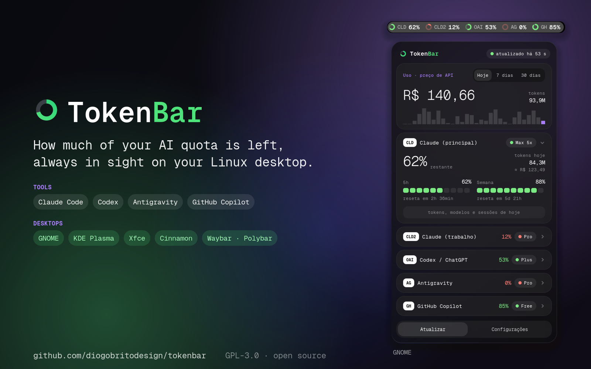

<p align="center"></p>

# TokenBar

**English** · [Português](README.pt-BR.md)



AI usage limits, always visible on your Linux desktop.

TokenBar shows how much of your **Claude Code**, **Codex / ChatGPT**,
**Cursor**, **Antigravity** and **GitHub Copilot** quota is left, and opens a
panel with the details when you click it. No Electron, no floating window: a
small collector writes a JSON file and a native piece of your desktop draws it.

### Works on

| Desktop | What you get |
| --- | --- |
| **GNOME** 48–50 | Native top-bar extension: a ring per account and the full panel. The most complete version. |
| **KDE Plasma**, **Xfce**, **Cinnamon**, MATE, Budgie… | Tray icon with the percentage inside the ring; a click opens **the same panel, with the same design**. |
| **Waybar** / **Polybar** (Sway, Hyprland, i3…) | A bar module with the percentages. |

`./install.sh` detects your desktop and installs the right one. Any distro
works (developed on Fedora; Ubuntu, Debian, Arch and openSUSE are covered by
the installer).


> The interface is available in English and Portuguese and follows your
> system language.

## Features

- **Top bar**: one ring per account that drains as you use the quota, coloured
  by how close you are to the limit. Compact modes: rings only, or only the
  most critical account.
- **Panel**: one collapsible card per account with 5-hour and weekly windows,
  reset countdowns and a "runs out in ~1h 20min" projection based on your
  recent pace.
- **Cost estimate**: what today's Claude usage would cost at API list prices
  (per model, including cache writes and reads), in USD or BRL, for today, the
  last 7 days or the last 30 days, with a daily chart.
- **Per-account details**: token breakdown, models used and the sessions
  (projects) that spent the most today. Click a session to open its folder.
- **Notifications** when a window crosses your red threshold, when it frees up
  again, when an account loses its login, and when you hit a daily spending
  goal.
- **Service status**: a banner appears only when status.claude.com reports an
  incident.
- **Settings inside the panel**: accounts, what the bar shows, colour
  thresholds, goals, currency, language, collector interval, position.
- Keyboard shortcut (`Super`+`Alt`+`T`) and CSV export of the daily history.
- **Dock icon** (optional, on every desktop): the TokenBar logo in the dock or
  taskbar. On GNOME a click opens the top-bar panel; elsewhere it opens the same
  panel and a second click minimizes it back to the bar. The icon is just the
  logo, with no numbers on it.
- **Update notice**: once a day it checks GitHub for a newer version and shows
  a banner (can be turned off) with an **Update now** button that runs
  `git pull && ./install.sh` for you in the folder you installed from, and
  only asks you to log out when the panel code itself changed. An **About**
  card in the settings shows the version, author, website and license.
- **Refreshes right after you use** Claude Code or Codex (at most once a
  minute), and at a fixed interval otherwise.
- Translucent panel with a light **background blur** (can be turned off).
- **Beyond GNOME**: on KDE Plasma, Xfce, Cinnamon, MATE and other desktops a
  tray icon (percentage drawn inside the ring) opens **the same panel**, with
  the same design. Output for Waybar and Polybar too.
- **No Node.js needed** with the extension package: the collector also runs on
  GJS, inside the extension.

## Supported providers

| Bar label | Tool | Where the data comes from | Notes |
| --- | --- | --- | --- |
| `CLD`, `CLD2`, `CLD3`… | Claude Code | `~/.claude` and any `~/.claude-<name>` (the ones you use with `CLAUDE_CONFIG_DIR`) | No fixed limit on how many accounts: every folder found is listed. Limits from Anthropic's usage endpoint with your existing login; tokens and cost from local transcripts. |
| `OAI` | Codex / ChatGPT | `~/.codex/auth.json` and `~/.codex/sessions` | Limits from the ChatGPT API; tokens and estimated cost from local rollouts. |
| `CUR`, `CUR2`… | Cursor | IDE login in `~/.config/Cursor` (and `~/.config/Cursor-<name>`), and/or the CLI file `~/.config/cursor/auth.json` | Plan-cycle usage from Cursor's dashboard API with the login already on disk. Same account in IDE and CLI is shown once; different accounts appear as separate cards. Needs `python3` to read the IDE database. |
| `AG` | Antigravity | The language server Antigravity itself runs on `127.0.0.1` | Works while the Antigravity IDE is open; otherwise shows the last known value. |
| `GH` | GitHub Copilot | The official `gh` CLI (`gh api`) | Monthly quotas. Needs `gh auth login`. |

**None of these tools is required.** TokenBar **discovers** whatever is on the
machine each time it collects: an account only appears if its folder or login
exists, and in the settings you choose which ones to collect and which ones to
show on the bar. There is no hard cap (Claude is not limited to two accounts,
and Cursor can show more than one when IDE and CLI are different people). You
can use it with Claude Code alone, for example, and you do not need Antigravity
or Cursor installed.

Claude Code, Codex, Cursor and Copilot are read the same way whether you use
them in a terminal, in VS Code or in any other editor. Antigravity is the only
one that depends on its own app: its card needs the Antigravity IDE running
(the `agy` terminal CLI on its own is not detected).

## Requirements

- GNOME Shell **48, 49 or 50** (developed and tested on Fedora 44 with GNOME
  50 on Wayland; 48 and 49 are declared compatible but not yet tested by the
  author; reports welcome).
- With `install.sh`: Node.js **20+** (no npm dependencies) and systemd user
  services (standard on Fedora, Ubuntu, Debian, Arch, openSUSE).
- With the extension package (`scripts/pack-extension.sh`): nothing beyond
  GNOME itself; it uses the `gjs` that ships with GNOME.
- `ss` from iproute2 (for Antigravity), `gh` (for Copilot) and `python3` (for
  the Cursor IDE login), all optional.

On desktops other than GNOME the extension is replaced by a tray icon (see
[Other desktops](#other-desktops)), which needs Python 3 with PyGObject.

## Install

```sh
git clone https://github.com/diogobritodesign/tokenbar.git
cd tokenbar
./install.sh
```

On GNOME, then **log out and back in** (only this first time, see below). On
other desktops the tray icon appears right away.

To update later, click **Update now** in the panel's update banner, or run
`git pull && ./install.sh`. You only need to log out again when the update
changed the GNOME panel's own code; the panel tells you which case it is.

### Without Node.js (extension package)

`scripts/pack-extension.sh` builds `dist/tokenbar@tokenbar.shell-extension.zip`:
the extension with a GJS port of the collector inside it. When the Node
service is not installed, the extension starts that collector itself as a
child process, so it needs neither Node.js nor systemd; this is the package
meant for extensions.gnome.org. Install it locally with
`gnome-extensions install dist/tokenbar@tokenbar.shell-extension.zip`, then log
out and back in. (The Geist Mono font is not bundled in this mode; the
interface falls back to another monospace font.)

`./uninstall.sh` removes everything: the service, the extension, settings, font,
cache and history. Use `./uninstall.sh --keep-data` to keep config, cache and
history.

## Other desktops

On **KDE Plasma, Xfce, Cinnamon, MATE, Budgie** and other desktops with a
system tray, `./install.sh` installs a **tray icon** instead of the GNOME
extension: a ring for the most critical account with its percentage drawn
inside. **Clicking it opens the same panel as the GNOME extension** (same
cards, rings, meters, font and colours, with settings inside), next to the
icon whether the bar is at the top or the bottom; a click anywhere else closes
it. Right-click keeps a plain menu. It starts at login. On GNOME you can add it
too with `./install.sh --tray` (it needs the AppIndicator extension).


It speaks the standard tray protocol (StatusNotifierItem) over D-Bus with
PyGObject, and draws the panel with GTK 4 (if GTK 4 is missing, the click
falls back to the menu). Python 3 with PyGObject is needed (`python3-gobject`
on Fedora/openSUSE, `python3-gi` on Debian/Ubuntu, `python-gobject` on Arch).
On Wayland, `gtk4-layer-shell` lets the panel open in the corner next to the
icon. Tested with real mouse clicks on KDE Plasma 6 (Wayland and X11), Xfce
and Cinnamon.

All of these can be changed in the panel's settings; they are stored in
`~/.config/tokenbar/config.json`:

```json
{ "language": "en", "dock": true, "bar": { "label": "critical", "showRemaining": true, "warn": 60, "crit": 85, "currency": "usd" } }
```

`label` can be `critical` (the most critical account), `all` or `none`.
`"dock": true` keeps TokenBar in the taskbar as a regular program (the logo
only): it starts minimized at login, a click on it opens the panel and the next
click minimizes it again.

### Waybar and Polybar

`tokenbar-collector --waybar` and `--polybar` print the current state (they
only read `state.json`, nothing is collected):

```jsonc
// ~/.config/waybar/config
"custom/tokenbar": {
  "exec": "tokenbar-collector --waybar",
  "return-type": "json",
  "interval": 30
}
```

```ini
; ~/.config/polybar/config.ini
[module/tokenbar]
type = custom/script
exec = tokenbar-collector --polybar
interval = 30
```

The Waybar module gets the class `ok`, `warn`, `crit` or `off` for styling.
Install with `./install.sh` as usual (the tray icon can then be closed from its
menu if you only want the bar module).

## How it works

```
 tools' own files / local servers / APIs
                 │  (read-only)
        ┌────────▼─────────┐   every 60–600 s    ┌──────────────────────────┐
        │  collector (Node) ├────────────────────►  ~/.cache/tokenbar/       │
        │  systemd --user   │  atomic write       │      state.json          │
        └───────────────────┘                     └────────────┬─────────────┘
                                                               │ file monitor
                                                  ┌────────────▼─────────────┐
                                                  │ GNOME Shell extension     │
                                                  │ (no network, async reads) │
                                                  └───────────────────────────┘
```

- The **collector** (`collector/`) is the same code in two runtimes: Node.js
  (the systemd service installed by `install.sh`) and GJS (bundled in the
  extension package). Everything that touches the system goes through
  `collector/src/platform/`, and a parity test checks that both write the same
  result. As a service it runs as `tokenbar-collector.service`. It
  collects at the interval set in the settings and also right after you use
  Claude Code or Codex (it watches their conversation folders), at most once a
  minute. Each
  provider has a 10 s network timeout and fails on its own without taking the
  others down. On HTTP 429 it keeps the last value and waits 5 minutes.
  `tokenbar-collector --once` forces a refresh (the panel's "Refresh"
  button).
- The **extension** (`extension/tokenbar@tokenbar/`) only reads `state.json` and
  draws. It makes no network requests and does nothing heavy inside the
  gnome-shell process.

Files it writes:

| Path | Content |
| --- | --- |
| `~/.cache/tokenbar/` | `state.json` and small caches (safe to delete) |
| `~/.local/state/tokenbar/history.json` | daily usage history, 120 days |
| `~/.config/tokenbar/config.json` | collector interval, disabled accounts, language and tray/bar options |
| `~/.config/autostart/tokenbar-tray.desktop` | starts the tray icon at login (tray only) |

## Privacy and security

- Credentials are read **only** to call each provider's own API. Nothing is
  written back to the tools' files, and expired tokens are never refreshed by
  TokenBar: you will be told to open the tool again instead.
- No token, e-mail or account id is written to `state.json`, to the caches or
  to the journal. An automated test checks every file the collector writes.
- TokenBar identifies itself honestly and does not impersonate other clients.
  That is why some things other monitors show are missing here; see
  [Limitations](#limitations).
- Three unauthenticated public services are contacted: an exchange-rate API
  (USD→BRL, at most twice a day), status.claude.com (every 5 minutes) and the
  GitHub API for the update check (once a day, can be turned off). Nothing
  about you is sent to them.

## About the cost figure

The amount shown is **what your usage would cost on the pay-per-token API**.
If you are on a subscription (Pro, Max…) you are not charged that; it is a way
to see how much the subscription is giving you. Prices are a hand-maintained
table in `collector/src/pricing.js`; usage of a model that is not in the table
is counted in tokens and flagged as "partial cost". Token totals include cache
reads, which are usually the vast majority; the per-account details show the
split.

## Limitations

- **The Antigravity card needs the Antigravity IDE open.** The rest of
  TokenBar does not. Its quota API only accepts tokens issued
  to Antigravity itself, so TokenBar asks the local language server instead of
  logging in on its own.
- **No Claude reset credits.** Anthropic only returns them to Claude Code
  itself.
- **Cursor**: the usage endpoint is the same undocumented dashboard API the
  Cursor website uses; it can change without notice. Reading the IDE login
  needs `python3`. Local Cursor token totals are not counted yet (plan-cycle
  limits only).
- Interface languages: English and Portuguese only (translation contributions
  welcome).
- **Tray icon**: the right-click menu is drawn by each desktop; the panel opened
  by a left click looks the same everywhere and opens next to the icon (on
  Wayland this needs gtk4-layer-shell; without it the desktop places the
  window). Tested with real clicks on KDE Plasma 6 (Wayland and X11), Xfce and
  Cinnamon, and on GNOME's tray host. GNOME shows the percentage as text next to
  the icon; Plasma, Xfce and Cinnamon don't support that text, so there the
  number is drawn inside the ring.

## Troubleshooting

```sh
systemctl --user status tokenbar-collector
journalctl --user -u tokenbar-collector -f      # errors only, one line each
journalctl -f /usr/bin/gnome-shell              # extension errors
tokenbar-collector --once && cat ~/.cache/tokenbar/state.json
```

**Why do I have to log out after some updates?** On Wayland, GNOME Shell *is*
your session: it loads each extension's JavaScript once and keeps it until you
log out, and restarting it would close every open app (the old `Alt+F2` → `r`
only existed on X11). This applies to every GNOME extension. Only changes to
the panel's own code need it: the collector, data, settings and the tray icon
on other desktops update immediately, and the **Update now** button tells you
whether a logout is needed. To try panel changes without logging out,
`scripts/preview.sh` opens a nested shell window.

## Development

```sh
npm test                    # 74 Node tests + 11 Python tests (tray)
scripts/ui-test.sh          # 58 checks against a real headless GNOME Shell
scripts/tray-test.sh        # 22 checks of the tray icon, its panel and the dock mode over D-Bus, same isolated setup
scripts/gjs-test.sh         # GJS platform against a local fake server + Node/GJS parity
scripts/embedded-test.sh    # packaged extension running its own GJS collector, no Node
scripts/preview.sh --demo   # nested shell with demo data
```

See [CONTRIBUTING.md](CONTRIBUTING.md) for the ground rules and how to add a
provider or a translation.

## Credits

Interface font: [Geist Mono](https://github.com/vercel/geist-font) (SIL OFL
1.1, see `fonts/OFL.txt`).

## License

[GPL-3.0-or-later](LICENSE). You are free to use, study, modify and share
TokenBar; if you distribute a modified version, it has to stay under the same
license with its source code available.
