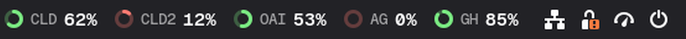
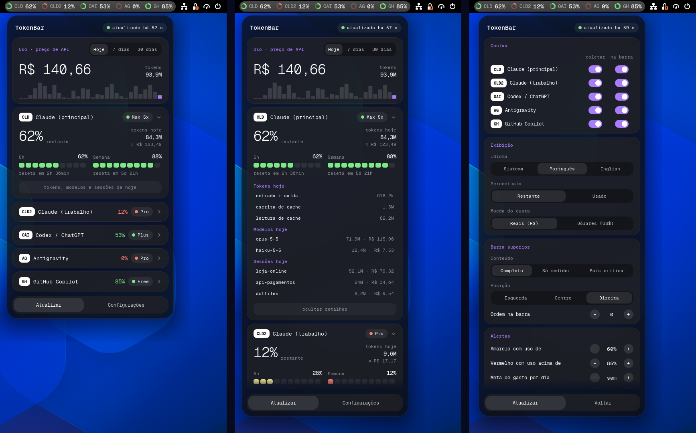

# TokenBar

[English](README.md) · **Português**

Limites de uso de IA, sempre visíveis na barra superior do GNOME.

O TokenBar mostra quanto resta da sua cota do **Claude Code**, **Codex /
ChatGPT**, **Antigravity** e **GitHub Copilot**, e abre um painel com os
detalhes ao clicar. Sem Electron, sem janela flutuante, sem overlay: um
coletor pequeno em Node grava um arquivo JSON e uma extensão nativa do GNOME
Shell desenha.





> A interface existe em português e em inglês e segue o idioma do sistema.

## Recursos

- **Barra superior**: um anel por conta, que esvazia conforme a cota é usada e
  muda de cor perto do limite. Modos compactos: só os anéis, ou só a conta
  mais crítica.
- **Painel**: um cartão recolhível por conta, com as janelas de 5 horas e
  semanal, contagem até o reset e a projeção "esgota em ~1h 20min" pelo seu
  ritmo recente.
- **Custo estimado**: quanto o uso do Claude custaria a preço de tabela da API
  (por modelo, com escrita e leitura de cache), em dólares ou reais, para
  hoje, 7 dias ou 30 dias, com gráfico diário.
- **Detalhes por conta**: divisão dos tokens, modelos usados e as sessões
  (projetos) que mais gastaram hoje. Clicar numa sessão abre a pasta.
- **Notificações** quando uma janela passa do limite vermelho, quando ela
  libera, quando uma conta perde o login e quando a meta de gasto do dia é
  atingida.
- **Status do serviço**: uma faixa aparece só quando o status.claude.com
  registra incidente.
- **Configurações dentro do painel**: contas, o que a barra mostra, limites de
  cor, metas, moeda, idioma, intervalo do coletor, posição.
- Atalho de teclado (`Super`+`Alt`+`T`) e exportação do histórico em CSV.

## Provedores

| Sigla | Ferramenta | De onde vêm os dados | Observações |
| --- | --- | --- | --- |
| `CLD`, `CLD2`… | Claude Code | `~/.claude` e qualquer `~/.claude-<nome>` (as usadas com `CLAUDE_CONFIG_DIR`) | Limites pelo endpoint de uso da Anthropic com o login que você já tem; tokens e custo pelos transcripts locais. |
| `OAI` | Codex / ChatGPT | `~/.codex/auth.json` | Só limites. |
| `AG` | Antigravity | O language server que o próprio Antigravity roda em `127.0.0.1` | Funciona com o Antigravity aberto; fechado, mostra o último valor. |
| `GH` | GitHub Copilot | A CLI oficial `gh` (`gh api`) | Cotas mensais. Precisa de `gh auth login`. |

Uma conta só aparece se a pasta dela existir na máquina, e cada uma pode ser
desligada nas configurações.

## Requisitos

- GNOME Shell **48, 49 ou 50** (desenvolvido e testado no Fedora 44 com GNOME
  50 em Wayland; 48 e 49 estão declarados como compatíveis mas ainda não foram
  testados pelo autor — relatos são bem-vindos).
- Node.js **20+**, sem dependências do npm.
- Serviços de usuário do systemd (padrão no Fedora, Ubuntu, Debian, Arch,
  openSUSE).
- `ss` do iproute2 (para o Antigravity) e `gh` (para o Copilot), opcionais.

É uma extensão do GNOME Shell: não funciona em KDE, Xfce, Cinnamon ou outros
ambientes.

## Instalar

```sh
git clone https://github.com/diogobritodesign/tokenbar.git
cd tokenbar
./install.sh
```

Depois **encerre a sessão e entre de novo**. No Wayland, o GNOME Shell só
carrega uma extensão nova (ou código novo de extensão) no início da sessão.

`./uninstall.sh` remove tudo: serviço, extensão, configurações, fonte, cache e
histórico.

## Como funciona

- O **coletor** (`collector/`) roda como `tokenbar-collector.service`. Cada
  provedor tem timeout de rede de 10 s e falha sozinho, sem derrubar os
  outros. Em HTTP 429 ele mantém o último valor e espera 5 minutos.
  `tokenbar-collector --once` força uma atualização (botão "Atualizar").
- A **extensão** (`extension/tokenbar@tokenbar/`) só lê o `state.json` e desenha.
  Não faz rede nem nada pesado dentro do processo do gnome-shell.

| Caminho | Conteúdo |
| --- | --- |
| `~/.cache/tokenbar/` | `state.json` e caches pequenos (pode apagar) |
| `~/.local/state/tokenbar/history.json` | histórico diário de uso, 120 dias |
| `~/.config/tokenbar/config.json` | intervalo do coletor e contas desligadas |

## Privacidade e segurança

- As credenciais são lidas **somente** para chamar a API do próprio provedor.
  Nada é gravado nos arquivos das ferramentas, e o TokenBar nunca renova um
  token expirado: ele avisa para você abrir a ferramenta.
- Nenhum token, e-mail ou id de conta vai para o `state.json`, para os caches
  ou para o journal. Um teste automatizado confere todos os arquivos gravados.
- O TokenBar se identifica com honestidade e não se passa por outros
  programas. Por isso faltam aqui algumas coisas que outros monitores mostram;
  veja [Limitações](#limitações).
- Dois serviços públicos são consultados sem autenticação: uma API de câmbio
  (dólar→real, no máximo duas vezes por dia) e o status.claude.com (a cada 5
  minutos). Nada sobre você é enviado a eles.

## Sobre o valor em dinheiro

O valor mostrado é **quanto o seu uso custaria na API paga por token**. Numa
assinatura (Pro, Max…) você não paga isso; serve para ver quanto a assinatura
está rendendo. Os preços são uma tabela mantida à mão em
`collector/src/pricing.js`; o uso de um modelo fora da tabela conta nos tokens
e é sinalizado como "custo parcial". O total de tokens inclui leitura de
cache, que costuma ser a grande maioria; os detalhes de cada conta mostram a
divisão.

## Limitações

- **O Antigravity precisa estar aberto.** A API de cotas dele só aceita tokens
  emitidos para o próprio Antigravity, então o TokenBar pergunta ao language
  server local em vez de fazer login por conta própria.
- **Sem créditos de reset do Claude.** A Anthropic só os devolve para o
  próprio Claude Code.
- **Codex**: só limites (ainda sem total de tokens locais), e o caminho de
  sucesso teve pouco teste em uso real.
- Totais de tokens e custo existem só para o Claude.
- A projeção "esgota em" não é calculada para cotas mensais.
- Idiomas da interface: só português e inglês.

## Resolução de problemas

```sh
systemctl --user status tokenbar-collector
journalctl --user -u tokenbar-collector -f      # só erros, uma linha cada
journalctl -f /usr/bin/gnome-shell              # erros da extensão
tokenbar-collector --once && cat ~/.cache/tokenbar/state.json
```

**Preciso mesmo encerrar a sessão depois de atualizar?** Para o *código* da
extensão, sim no Wayland: o GNOME Shell não recarrega o JavaScript de uma
extensão com a sessão aberta. Dados, configurações e o coletor nunca precisam
disso. Para ver mudanças sem encerrar a sessão, `scripts/preview.sh` abre um
shell aninhado numa janela.

## Desenvolvimento

```sh
npm test                    # 54 testes de unidade/integração, só Node
scripts/ui-test.sh          # 40 verificações num GNOME Shell headless de verdade
scripts/preview.sh --demo   # shell aninhado com dados de demonstração
```

Veja o [CONTRIBUTING.pt-BR.md](CONTRIBUTING.pt-BR.md) para as regras e como
adicionar um provedor ou uma tradução.

## Créditos

Fonte da interface: [Geist Mono](https://github.com/vercel/geist-font) (SIL
OFL 1.1, veja `fonts/OFL.txt`).

## Licença

[GPL-3.0-or-later](LICENSE). Você pode usar, estudar, modificar e compartilhar
o TokenBar; se distribuir uma versão modificada, ela precisa continuar sob a
mesma licença, com o código-fonte disponível.
