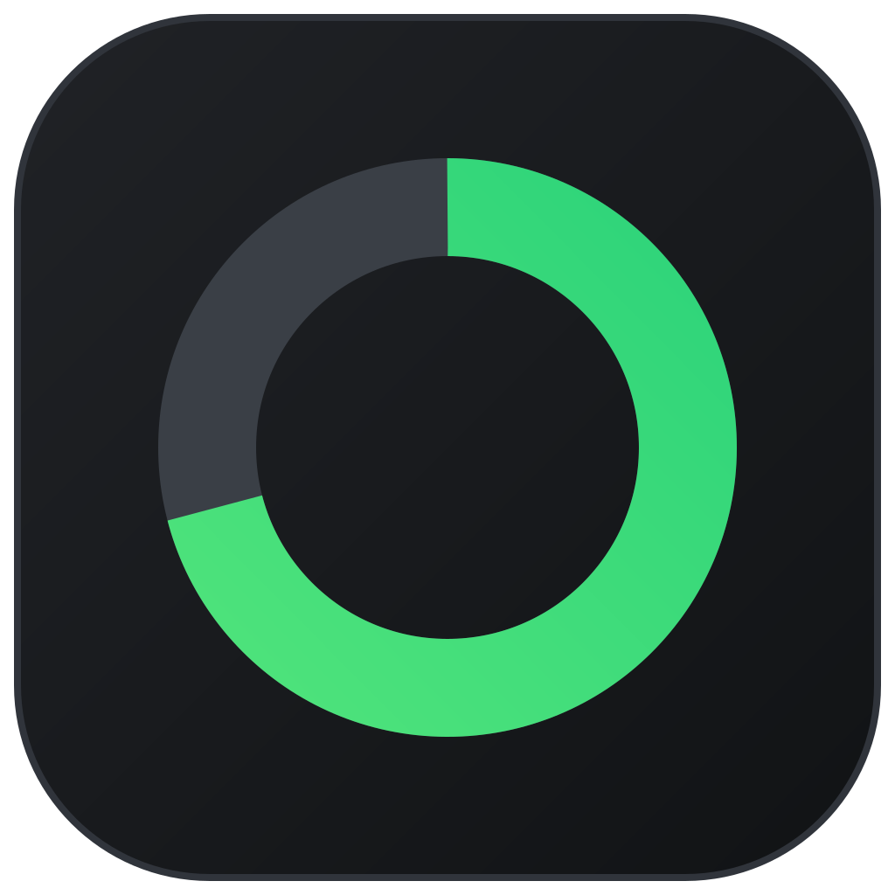
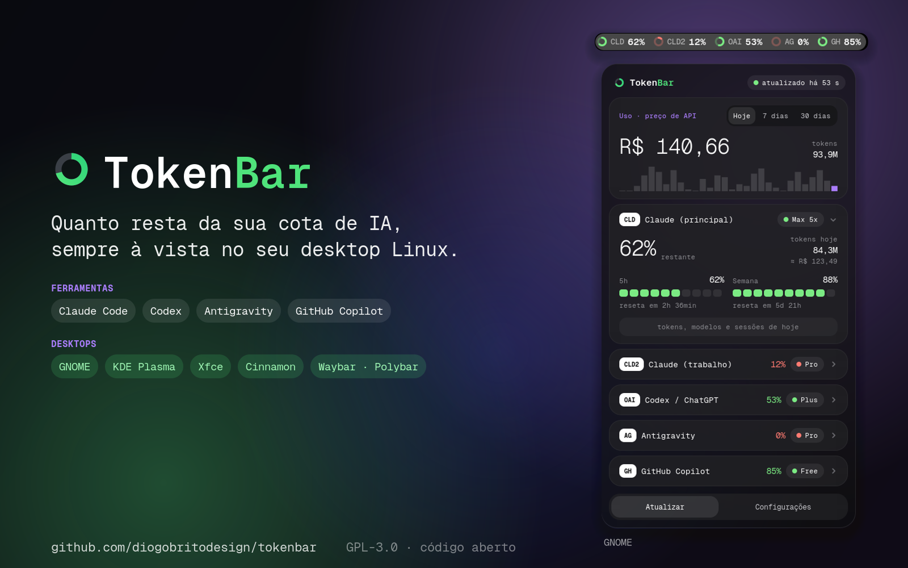
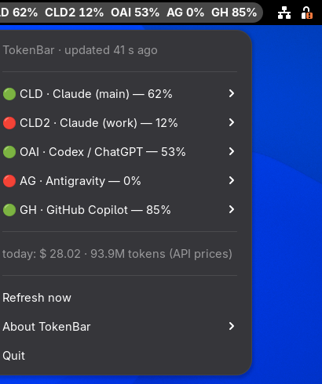

<p align="center"></p>

# TokenBar

[English](README.md) · **Português**



Limites de uso de IA, sempre visíveis no seu desktop Linux.

O TokenBar mostra quanto resta da sua cota do **Claude Code**, **Codex /
ChatGPT**, **Antigravity** e **GitHub Copilot**, e abre um painel com os
detalhes ao clicar. Sem Electron, sem janela flutuante: um coletor pequeno
grava um arquivo JSON e uma parte nativa do seu desktop desenha.

### Funciona em

| Desktop | O que você tem |
| --- | --- |
| **GNOME** 48–50 | Extensão nativa na barra superior: um anel por conta e o painel completo. A versão mais completa. |
| **KDE Plasma**, **Xfce**, **Cinnamon**, MATE, Budgie… | Ícone na bandeja com o percentual dentro do anel; o clique abre **o mesmo painel, com o mesmo design**. |
| **Waybar** / **Polybar** (Sway, Hyprland, i3…) | Um módulo de barra com os percentuais. |

O `./install.sh` detecta o seu desktop e instala a versão certa. Funciona em
qualquer distro (desenvolvido no Fedora; o instalador cobre Ubuntu, Debian,
Arch e openSUSE).


> A interface existe em português e em inglês e segue o idioma do sistema.

## Recursos

- **Barra superior**: um anel por conta, que esvazia conforme a cota é usada e
  muda de cor perto do limite. Modos compactos: só os anéis, ou só a conta
  mais crítica.
- **Painel**: um cartão recolhível por conta, com as janelas de 5 horas e
  semanal, contagem até o reset e a projeção "esgota em ~1h 20min" pelo seu
  ritmo recente.
- **Custo estimado**: quanto o uso do Claude custaria a preço de tabela da API
  (por modelo, com escrita e leitura de cache), em dólares ou reais, para
  hoje, 7 dias ou 30 dias, com gráfico diário.
- **Detalhes por conta**: divisão dos tokens, modelos usados e as sessões
  (projetos) que mais gastaram hoje. Clicar numa sessão abre a pasta.
- **Notificações** quando uma janela passa do limite vermelho, quando ela
  libera, quando uma conta perde o login e quando a meta de gasto do dia é
  atingida.
- **Status do serviço**: uma faixa aparece só quando o status.claude.com
  registra incidente.
- **Configurações dentro do painel**: contas, o que a barra mostra, limites de
  cor, metas, moeda, idioma, intervalo do coletor, posição.
- Atalho de teclado (`Super`+`Alt`+`T`) e exportação do histórico em CSV.
- **Ícone na dock** (opcional, em qualquer desktop): a logo do TokenBar na dock
  ou na barra de tarefas. No GNOME, o clique abre o painel da barra de cima; nos
  outros desktops, abre o mesmo painel, e um segundo clique minimiza de volta
  para a barra. O ícone é só a logo, sem número.
- **Aviso de atualização**: uma vez por dia confere no GitHub se há versão nova
  e mostra uma faixa no painel (dá para desligar), com um botão **Atualizar
  agora** que roda `git pull && ./install.sh` sozinho na pasta de onde você
  instalou, e só pede para sair da sessão quando o código do painel mudou. Um
  cartão **Sobre** nas configurações mostra a versão, o autor, o site e a
  licença.
- **Atualiza logo depois que você usa** o Claude Code ou o Codex (no máximo uma
  vez por minuto) e, fora isso, no intervalo definido.
- Painel translúcido com **desfoque leve do fundo** (dá para desligar).
- **Além do GNOME**: no KDE Plasma, Xfce, Cinnamon, MATE e outros desktops, um
  ícone de bandeja (com o percentual dentro do anel) abre **o mesmo painel**,
  com o mesmo design. Também tem saída para Waybar e Polybar.
- **Sem precisar de Node.js** com o pacote da extensão: o coletor também roda
  em GJS, dentro da extensão.

## Provedores

| Sigla | Ferramenta | De onde vêm os dados | Observações |
| --- | --- | --- | --- |
| `CLD`, `CLD2`… | Claude Code | `~/.claude` e qualquer `~/.claude-<nome>` (as usadas com `CLAUDE_CONFIG_DIR`) | Limites pelo endpoint de uso da Anthropic com o login que você já tem; tokens e custo pelos transcripts locais. |
| `OAI` | Codex / ChatGPT | `~/.codex/auth.json` | Só limites. |
| `AG` | Antigravity | O language server que o próprio Antigravity roda em `127.0.0.1` | Funciona com o Antigravity IDE aberto; fechado, mostra o último valor. |
| `GH` | GitHub Copilot | A CLI oficial `gh` (`gh api`) | Cotas mensais. Precisa de `gh auth login`. |

**Nenhuma dessas ferramentas é obrigatória.** O TokenBar mostra as que você
tiver: uma conta só aparece se a pasta dela existir na máquina, e cada uma
pode ser desligada nas configurações. Dá para usar só com o Claude Code, por
exemplo, e não é preciso ter o Antigravity instalado.

Claude Code, Codex e Copilot são lidos do mesmo jeito, não importa se você os
usa no terminal, no VS Code ou em outro editor. O Antigravity é o único que
depende do próprio programa: o cartão dele precisa do Antigravity IDE aberto
(a CLI de terminal `agy` sozinha não é detectada).

## Requisitos

- GNOME Shell **48, 49 ou 50** (desenvolvido e testado no Fedora 44 com GNOME
  50 em Wayland; 48 e 49 estão declarados como compatíveis mas ainda não foram
  testados pelo autor — relatos são bem-vindos).
- Pelo `install.sh`: Node.js **20+** (sem dependências do npm) e serviços de
  usuário do systemd (padrão no Fedora, Ubuntu, Debian, Arch, openSUSE).
- Pelo pacote da extensão (`scripts/pack-extension.sh`): nada além do próprio
  GNOME; ele usa o `gjs` que já vem com o GNOME.
- `ss` do iproute2 (para o Antigravity) e `gh` (para o Copilot), opcionais.

Fora do GNOME, a extensão é trocada por um ícone de bandeja (veja
[Outros desktops](#outros-desktops)), que precisa do Python 3 com PyGObject.

## Instalar

```sh
git clone https://github.com/diogobritodesign/tokenbar.git
cd tokenbar
./install.sh
```

No GNOME, depois **encerre a sessão e entre de novo** (só desta primeira vez,
veja abaixo). Nos outros desktops o ícone aparece na hora.

Para atualizar depois, clique em **Atualizar agora** na faixa de atualização
do painel, ou rode `git pull && ./install.sh`. Só é preciso sair da sessão de
novo quando a atualização mudou o código do próprio painel do GNOME; o painel
avisa qual é o caso.

### Sem Node.js (pacote da extensão)

O `scripts/pack-extension.sh` gera o `dist/tokenbar@tokenbar.shell-extension.zip`:
a extensão com uma versão do coletor em GJS dentro dela. Quando o serviço em
Node não está instalado, a própria extensão roda esse coletor como processo
filho, então não precisa de Node.js nem de systemd; é o pacote pensado para o
extensions.gnome.org. Para instalar localmente:
`gnome-extensions install dist/tokenbar@tokenbar.shell-extension.zip`, e
depois entrar de novo na sessão. (A fonte Geist Mono não vem nesse modo; a
interface usa outra fonte monoespaçada.)

`./uninstall.sh` remove tudo: serviço, extensão, configurações, fonte, cache e
histórico.

## Outros desktops

No **KDE Plasma, Xfce, Cinnamon, MATE, Budgie** e outros desktops com bandeja
do sistema, o `./install.sh` instala um **ícone de bandeja** no lugar da
extensão do GNOME: um anel da conta mais crítica, com o percentual desenhado
dentro. **O clique abre o mesmo painel da extensão do GNOME** (mesmos cartões,
anéis, medidores, fonte e cores, com as configurações dentro), junto do ícone,
com a barra em cima ou embaixo; um clique em qualquer outro lugar fecha. O
botão direito mantém um menu simples. Ele abre sozinho no login. No GNOME dá
para adicionar também com `./install.sh --tray` (precisa da extensão
AppIndicator).



Ele fala o protocolo padrão de bandeja (StatusNotifierItem) pelo D-Bus usando
PyGObject e desenha o painel com GTK 4 (sem GTK 4, o clique volta a abrir o
menu). Precisa do Python 3 com PyGObject (`python3-gobject` no
Fedora/openSUSE, `python3-gi` no Debian/Ubuntu, `python-gobject` no Arch). No
Wayland, o `gtk4-layer-shell` faz o painel abrir no canto, junto do ícone.
Testado com cliques reais do mouse no KDE Plasma 6 (Wayland e X11), Xfce e
Cinnamon.

Tudo isso dá para mudar nas configurações do painel; fica guardado em
`~/.config/tokenbar/config.json`:

```json
{ "language": "pt", "dock": true, "bar": { "label": "critical", "showRemaining": true, "warn": 60, "crit": 85, "currency": "brl" } }
```

`label` pode ser `critical` (a conta mais crítica), `all` ou `none`.
`"dock": true` deixa o TokenBar na barra de tarefas como um programa comum (só
a logo): ele abre minimizado no login, um clique nele abre o painel e o
seguinte minimiza de novo.

### Waybar e Polybar

`tokenbar-collector --waybar` e `--polybar` imprimem o estado atual (só leem o
`state.json`, não coletam nada):

```jsonc
// ~/.config/waybar/config
"custom/tokenbar": {
  "exec": "tokenbar-collector --waybar",
  "return-type": "json",
  "interval": 30
}
```

```ini
; ~/.config/polybar/config.ini
[module/tokenbar]
type = custom/script
exec = tokenbar-collector --polybar
interval = 30
```

O módulo da Waybar recebe a classe `ok`, `warn`, `crit` ou `off` para estilo.
Instale com o `./install.sh` normalmente (se quiser só o módulo da barra, dá
para fechar o ícone de bandeja pelo menu dele).

## Como funciona

- O **coletor** (`collector/`) é o mesmo código em dois ambientes: Node.js (o
  serviço do systemd instalado pelo `install.sh`) e GJS (embutido no pacote da
  extensão). Tudo o que toca o sistema passa por `collector/src/platform/`, e
  um teste de paridade confere que os dois gravam o mesmo resultado. Como
  serviço, roda como `tokenbar-collector.service`. Ele
  coleta no intervalo das configurações e também logo depois que você usa o
  Claude Code ou o Codex (observa as pastas de conversa), no máximo uma vez por
  minuto. Cada
  provedor tem timeout de rede de 10 s e falha sozinho, sem derrubar os
  outros. Em HTTP 429 ele mantém o último valor e espera 5 minutos.
  `tokenbar-collector --once` força uma atualização (botão "Atualizar").
- A **extensão** (`extension/tokenbar@tokenbar/`) só lê o `state.json` e desenha.
  Não faz rede nem nada pesado dentro do processo do gnome-shell.

| Caminho | Conteúdo |
| --- | --- |
| `~/.cache/tokenbar/` | `state.json` e caches pequenos (pode apagar) |
| `~/.local/state/tokenbar/history.json` | histórico diário de uso, 120 dias |
| `~/.config/tokenbar/config.json` | intervalo do coletor, contas desligadas, idioma e opções da bandeja/barra |
| `~/.config/autostart/tokenbar-tray.desktop` | abre o ícone de bandeja no login (só na bandeja) |

## Privacidade e segurança

- As credenciais são lidas **somente** para chamar a API do próprio provedor.
  Nada é gravado nos arquivos das ferramentas, e o TokenBar nunca renova um
  token expirado: ele avisa para você abrir a ferramenta.
- Nenhum token, e-mail ou id de conta vai para o `state.json`, para os caches
  ou para o journal. Um teste automatizado confere todos os arquivos gravados.
- O TokenBar se identifica com honestidade e não se passa por outros
  programas. Por isso faltam aqui algumas coisas que outros monitores mostram;
  veja [Limitações](#limitações).
- Três serviços públicos são consultados sem autenticação: uma API de câmbio
  (dólar→real, no máximo duas vezes por dia), o status.claude.com (a cada 5
  minutos) e a API do GitHub para o aviso de atualização (uma vez por dia, dá
  para desligar). Nada sobre você é enviado a eles.

## Sobre o valor em dinheiro

O valor mostrado é **quanto o seu uso custaria na API paga por token**. Numa
assinatura (Pro, Max…) você não paga isso; serve para ver quanto a assinatura
está rendendo. Os preços são uma tabela mantida à mão em
`collector/src/pricing.js`; o uso de um modelo fora da tabela conta nos tokens
e é sinalizado como "custo parcial". O total de tokens inclui leitura de
cache, que costuma ser a grande maioria; os detalhes de cada conta mostram a
divisão.

## Limitações

- **O cartão do Antigravity precisa do Antigravity IDE aberto.** O resto do
  TokenBar, não. A API de cotas dele só aceita tokens
  emitidos para o próprio Antigravity, então o TokenBar pergunta ao language
  server local em vez de fazer login por conta própria.
- **Sem créditos de reset do Claude.** A Anthropic só os devolve para o
  próprio Claude Code.
- **Codex**: só limites (ainda sem total de tokens locais), e o caminho de
  sucesso teve pouco teste em uso real.
- Totais de tokens e custo existem só para o Claude.
- A projeção "esgota em" não é calculada para cotas mensais.
- Idiomas da interface: só português e inglês.
- **Ícone de bandeja**: o menu do botão direito é desenhado por cada desktop; o
  painel do clique esquerdo é igual em todos e abre junto do ícone (no
  Wayland isso precisa do gtk4-layer-shell; sem ele, o desktop posiciona a
  janela). Testado com cliques reais no KDE Plasma 6 (Wayland e X11), Xfce e
  Cinnamon, e no host de bandeja do GNOME. O GNOME mostra o percentual em texto ao
  lado do ícone; Plasma, Xfce e Cinnamon não aceitam esse texto, então lá o
  número vai desenhado dentro do anel.

## Resolução de problemas

```sh
systemctl --user status tokenbar-collector
journalctl --user -u tokenbar-collector -f      # só erros, uma linha cada
journalctl -f /usr/bin/gnome-shell              # erros da extensão
tokenbar-collector --once && cat ~/.cache/tokenbar/state.json
```

**Por que algumas atualizações pedem para sair da sessão?** No Wayland, o
GNOME Shell *é* a sua sessão: ele carrega o JavaScript de cada extensão uma
vez e mantém até você sair, e reiniciá-lo fecharia todos os programas abertos
(o antigo `Alt+F2` → `r` só existia no X11). Isso vale para qualquer extensão
do GNOME. Só mudanças no código do painel precisam disso: o coletor, os dados,
as configurações e o ícone de bandeja nos outros desktops atualizam na hora, e
o botão **Atualizar agora** avisa se é preciso sair. Para ver mudanças no
painel sem sair, `scripts/preview.sh` abre um shell aninhado numa janela.

## Desenvolvimento

```sh
npm test                    # 69 testes em Node + 11 em Python (bandeja)
scripts/ui-test.sh          # 58 verificações num GNOME Shell headless de verdade
scripts/tray-test.sh        # 22 verificações da bandeja, do painel e do modo dock pelo D-Bus, no mesmo esquema isolado
scripts/gjs-test.sh         # plataforma GJS contra um servidor local de mentira + paridade Node/GJS
scripts/embedded-test.sh    # extensão empacotada rodando o próprio coletor em GJS, sem Node
scripts/preview.sh --demo   # shell aninhado com dados de demonstração
```

Veja o [CONTRIBUTING.pt-BR.md](CONTRIBUTING.pt-BR.md) para as regras e como
adicionar um provedor ou uma tradução.

## Créditos

Fonte da interface: [Geist Mono](https://github.com/vercel/geist-font) (SIL
OFL 1.1, veja `fonts/OFL.txt`).

## Licença

[GPL-3.0-or-later](LICENSE). Você pode usar, estudar, modificar e compartilhar
o TokenBar; se distribuir uma versão modificada, ela precisa continuar sob a
mesma licença, com o código-fonte disponível.
